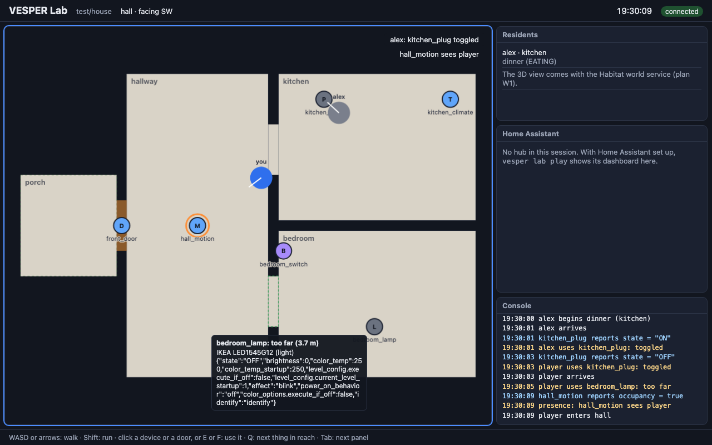

# VESPER Studio

**An open smart-home lab for any researcher's computer: real market products as virtual twins, in furnished homes you
can walk, with an unmodified Home Assistant as the hub, and evidence for how faithful each twin is.** No radios,
containers or special hardware.

VESPER turns the products in the smart-home ecosystem's public catalogs (Zigbee2MQTT's device definitions, the Matter
data model and the CSA's Distributed Compliance Ledger, Tasmota's device templates and the Z-Wave JS database: 14,234
records) into virtual devices, *twins*, and says for every product how far its twin can be trusted. You place twins in
a home: a small test house, a generated floor plan, or a furnished house from the HSSD 3D dataset. Residents live
their day there, you can walk the home yourself as in a game, and Home Assistant sees the twins exactly as it would see
the real products, through the same integrations. You can run an attack from a paper and its defense on the home,
claim by claim. Every session is recorded and replays exactly.

VESPER is research software under active development, released under the MIT license. It runs from a terminal, with
its pages in your browser, or as a desktop app for macOS and Windows.

## Contents

- [Is VESPER for you?](#is-vesper-for-you)
- [Choose what to install](#choose-what-to-install)
- [Install](#install)
  - [1. Prerequisites](#1-prerequisites)
  - [2. Get VESPER](#2-get-vesper)
  - [3. The device catalog](#3-the-device-catalog)
  - [4. Check your machine](#4-check-your-machine)
  - [5. Optional parts](#5-optional-parts)
  - [6. The desktop app](#6-the-desktop-app)
  - [7. Update and uninstall](#7-update-and-uninstall)
- [First steps: fifteen minutes](#first-steps-fifteen-minutes)
- [Concepts](#concepts)
- [Using VESPER](#using-vesper)
  - [Play a home](#play-a-home)
  - [Home Assistant in the loop](#home-assistant-in-the-loop)
  - [The home's network](#the-homes-network)
  - [Attacks and defenses from a paper: scenarios](#attacks-and-defenses-from-a-paper-scenarios)
  - [From a paper, with an AI assistant: the MCP server](#from-a-paper-with-an-ai-assistant-the-mcp-server)
  - [A day in seconds, and exact replays](#a-day-in-seconds-and-exact-replays)
  - [Choosing products](#choosing-products)
  - [Generated homes](#generated-homes)
  - [Furniture](#furniture)
  - [A home in a real place: sun, weather, windows](#a-home-in-a-real-place-sun-weather-windows)
  - [Checking a layout](#checking-a-layout)
  - [A custom look in Blender (optional)](#a-custom-look-in-blender-optional)
  - [A home from a real 3D scene (HSSD)](#a-home-from-a-real-3d-scene-hssd)
  - [Residents and their routines](#residents-and-their-routines)
  - [Checking the page automatically](#checking-the-page-automatically)
- [The evidence: validation and the fidelity report](#the-evidence-validation-and-the-fidelity-report)
- [Reference](#reference)
- [Troubleshooting](#troubleshooting)
- [Development](#development)
- [Limits and roadmap](#limits-and-roadmap)
- [Citing VESPER](#citing-vesper)
- [License and data](#license-and-data)

## Is VESPER for you?

VESPER is for research that needs smart-home devices but not a shelf of hardware:

- **Security and privacy:** reproduce an attack or a defense from a paper on a home with real products and a real
  hub, under controlled conditions, and rerun it exactly.
- **Automation and platform testing:** run Home Assistant's own automations over many products, including products
  you do not own, and see what the hub does.
- **Activity and sensing data:** let residents live days in a house and record what every sensor reports, when, and
  why.
- **Product differences:** swap one product for another and see whether a result changes.

What VESPER is not, so you can decide early:

- **Not a radio simulator.** A Zigbee twin speaks Zigbee2MQTT's MQTT interface, not 802.15.4; there is no signal
  strength, mesh routing or interference below that interface. The home's network model adds latency and loss above
  it. A Matter twin is a real Matter node, but on IP, not Thread.
- **Not the vendor's firmware.** A twin is generated from the product's public description. How closely it matches
  the physical product is what its fidelity level says, and for most products timing is *not* the product's own
  (see [Concepts](#concepts)).
- **Not a cloud.** Vendor clouds and trigger-action services are not emulated; their latency can be sampled.
- **Not a realistic-behaviour model.** Residents follow scripted routines. They make a home live; they are not a
  model of people.

## Choose what to install

VESPER is layered. The core is enough to play homes and run attacks on VESPER's own automation engine; each optional
part adds one thing. Install the core first and add parts when you need them; `vesper doctor` tells you, for every
missing part, which commands need it.

| Part | What it adds | Needs | Time, disk |
|---|---|---|---|
| **Core** (required) | the catalog, homes, the play page, residents, days in seconds, scenarios on the logical clock, replays, generated homes | Python 3.11+, uv, Node.js 20+ | 10 min, ~0.5 GB |
| **Home Assistant** | a real, unmodified Home Assistant as the hub; live scenario runs; validation checks | Mosquitto, `vesper setup ha` | 5 min, ~1 GB |
| **Matter** | Matter devices as real Matter nodes, commissioned by Home Assistant | Node.js, `vesper setup matter`, a network interface with multicast | 3 min, ~0.4 GB |
| **Habitat + HSSD** | homes from furnished 3D houses, Habitat's humanoid avatars | conda or micromamba, a Hugging Face account | 15 min, ~1.5 GB + ~80 MB per scene |
| **Blender** | furnish a generated home, by hand or with Claude through Blender MCP | Blender 4.2+ | — |
| **MCP server** | an AI assistant (Claude Desktop, LM Studio, any MCP client) sets up a paper's attack | an MCP client | 1 min |
| **Desktop app** | VESPER Studio, a window around the lobby | the core installed | 1 min |
| **A browser for checks** | `vesper lab look`: the page driven and screenshotted automatically | Google Chrome or another Chromium | — |

Tested on macOS on Apple silicon (an M4 MacBook Pro, 24 GB). Linux should work the same way and is less tested. On
Windows, VESPER runs inside WSL2 (Habitat and Home Assistant have no native Windows build) and the desktop app talks
to it there.

## Install

The commands below assume you work in the repository's folder (`vesper_studio`); VESPER keeps its stack (Home
Assistant, the broker, Matter) in `.vesper/` there and remembers where things are, so its commands then work from any
folder.

### 1. Prerequisites

**macOS** (with [Homebrew](https://brew.sh)):

    xcode-select --install                 # git and a compiler, if you do not have them
    brew install uv node mosquitto         # uv (Python), Node.js (the catalog, Matter), Mosquitto (Home Assistant)

`brew` installs Mosquitto as a program only; VESPER starts its own instance when it needs one, on its own port. You do
not need to start Mosquitto's service.

**Linux** (Ubuntu 22.04 or 24.04; adapt for your distribution):

    sudo apt update
    sudo apt install -y git curl build-essential mosquitto
    sudo systemctl disable --now mosquitto          # optional: VESPER starts its own broker; the system one is not needed
    curl -LsSf https://astral.sh/uv/install.sh | sh # uv
    curl -fsSL https://deb.nodesource.com/setup_22.x | sudo -E bash - && sudo apt install -y nodejs   # Node.js 22

**Windows:** install WSL2 with Ubuntu, then follow the Linux steps *inside* Ubuntu.

    wsl --install -d Ubuntu-24.04          # in PowerShell, as administrator; restart when asked

Everything below runs in the Ubuntu terminal. The desktop app (step 6) runs on Windows and starts VESPER inside WSL2.

Check the versions:

    uv --version          # any recent uv
    node --version        # v20 or newer
    mosquitto -h | head -1

uv downloads a suitable Python by itself; you do not need a system Python 3.11+.

### 2. Get VESPER

    git clone https://github.com/huuhuannt1998/vesper_studio.git
    cd vesper_studio

Then install it one of two ways.

**To use VESPER** (recommended): install the `vesper` command, with its own Python, from your clone:

    uv tool install --python 3.12 --editable .
    vesper --help

`--editable` means a `git pull` updates the command without reinstalling. If your shell does not find `vesper`, run
`uv tool update-shell` and open a new terminal.

**To develop VESPER**: a virtual environment in the clone, with the test tools:

    uv venv --python 3.12 .venv
    uv pip install --python .venv/bin/python -e ".[dev]"
    source .venv/bin/activate

The package's name is `vesper-studio`; its command and Python module are `vesper`. It is not on PyPI yet, so
`pip install vesper-studio` does not work; install from the clone.

### 3. The device catalog

Every command that runs twins needs the catalog. Build it from the pinned upstream sources:

    vesper catalog sync        # downloads the pinned sources: ~185 MB, a few minutes, needs the network
    vesper catalog build       # builds the catalog offline: about a minute, ~0.6 GB of memory, 63 MB on disk

`sync` fetches exactly the versions VESPER pins (Zigbee2MQTT's converters, the Matter data model, Tasmota's templates,
Z-Wave JS's database, Home Assistant's vocabulary) and keeps each with its hash under `catalog/raw/`. The Matter DCL is
a live ledger; `sync` reads it as it stood at a pinned block (324,961), so everyone gets the same Matter products.
`vesper catalog sync --source dcl --dcl-height latest` reads the newest block instead, and your catalog then differs
from the pinned one.
`build` turns them into one device spec per product under `catalog/vds/`, with a coverage summary.

**Rebuild after every update.** The catalog records which catalog code built it, and every command that runs twins
refuses a catalog built by other code ("the catalog … is stale"), because a stale catalog once carried a units bug
silently into a run. `vesper catalog build` fixes it in a minute.

When a release of VESPER publishes a catalog bundle, you can install it instead of building (its SHA-256 is in the
release notes; a bundle that does not match is refused). A release bundle leaves out the Matter DCL's products until
the DCL's redistribution terms are settled; build locally for the full catalog.

    vesper catalog fetch <bundle URL or file> --sha256 <hash>

### 4. Check your machine

    vesper doctor

The doctor checks every part and says, for each missing one, which commands need it and how to fix it. On a machine
with only the core, expect something like:

    ok   python          3.12.12
    ok   catalog         /home/you/vesper_studio/catalog/vds is current
    ok   mosquitto       /usr/sbin/mosquitto
    no   home assistant  not installed
                         needed by live runs (Home Assistant in the loop); vesper setup ha
    ok   node            v22.11.0
    no   matter host     not installed
                         needed by Matter devices on Home Assistant; vesper setup matter
    no   habitat         not found
                         needed by homes from HSSD scenes; vesper setup habitat
    ...
    ok   port 18830      free
    ok   port 18123      free
    configuration: /home/you/.config/vesper/config.json

Anything marked `no` is optional unless you need what it is for.

### 5. Optional parts

**Home Assistant** (a real hub in the loop; needed for live runs and most validation checks):

    vesper setup ha            # Home Assistant Core in its own virtual environment under .vesper/ha (~1 GB)

VESPER onboards Home Assistant through its public API, as a user would, and configures its MQTT, Tasmota and Matter
integrations. It never runs on Home Assistant's standard port 8123 or Mosquitto's 1883, so it does not disturb a Home
Assistant or broker you already run. The login VESPER creates for its pages is kept in `.vesper/ha/lab-login.json`
(readable only by you).

**Matter** (Matter devices on Home Assistant):

    vesper setup matter        # the Matter host (matter.js) and Home Assistant's Matter Server, under .vesper/matter

Matter does not run over loopback: the Matter devices announce themselves by mDNS on a network interface you name
(`--matter-interface en0` on a Mac's Wi-Fi). Other machines on that network can see the announcements; they cannot
commission the devices without their pairing codes. See [Home Assistant in the loop](#home-assistant-in-the-loop).

**Habitat and HSSD** (homes from furnished 3D houses):

1. Create an account on [Hugging Face](https://huggingface.co), open
   [hssd/hssd-hab](https://huggingface.co/datasets/hssd/hssd-hab), and accept the dataset's terms (CC BY-NC 4.0).
2. Log in on this machine (the `hf` command comes with `huggingface_hub`):

       uvx --from huggingface_hub hf auth login     # paste a read token from your Hugging Face settings

3. Install [Miniconda](https://docs.anaconda.com/miniconda/) or micromamba, then let VESPER make the Habitat
   environment (habitat-sim 0.3.3 on Python 3.9, ~1.5 GB) and fetch a scene:

       vesper setup habitat                 # conda environment `vesper-habitat`
       vesper setup scenes 102344022        # one HSSD scene, exactly the files it needs (~80 MB)

4. Optional, for Habitat's humanoid avatars instead of plain figures (in the Habitat environment):

       conda run -n vesper-habitat python -m habitat_sim.utils.datasets_download --uids habitat_humanoids --data-path data/

`vesper setup all` does Home Assistant, Matter and Habitat in one go, skipping what is already done. VESPER remembers
where Habitat, HSSD and the humanoids are in `~/.config/vesper/config.json`; a flag or an environment variable still
wins (see [Reference](#reference)).

**MCP server** (an AI assistant sets up scenarios; see [the MCP server](#from-a-paper-with-an-ai-assistant-the-mcp-server)):

    vesper setup claude-desktop --homes ~/vesper-homes   # registers VESPER with Claude Desktop; its config is backed up first
    vesper mcp --print-config --homes ~/vesper-homes     # the JSON for any other MCP client

**Blender and Claude** (furnishing generated homes): install [Blender](https://www.blender.org/download/) 4.2 or
newer. For furnishing with Claude, also install [Claude Code](https://claude.com/claude-code) (the `claude` command)
and the add-on of [Blender MCP](https://github.com/ahujasid/blender-mcp) (`addon.py`: in Blender, Edit, Preferences,
Add-ons, Install from disk); VESPER runs the MCP server itself (`uvx mcp-for-blender`, so `uv` is needed too). Blender
is needed only to make a home's model, not to play it.

**A browser for automatic checks**: `vesper lab look` uses Google Chrome or any Chromium-based browser it finds; set
`VESPER_BROWSER` to its executable otherwise.

### 6. The desktop app

VESPER Studio is a window around VESPER's lobby (`vesper studio`): your homes, a button to compose a new one, what the
machine has, and buttons that run the setup in the background. It starts VESPER when it opens and stops it when it
closes. **It needs VESPER installed first** (steps 2 and 3, and on Windows inside WSL2).

Get the app one of two ways:

- **Download** an unsigned build from the repository's
  [Actions](https://github.com/huuhuannt1998/vesper_studio/actions/workflows/studio-app.yml) (the latest successful
  run's artifacts: a `.dmg` for macOS, an `.msi` installer for Windows), or from a release when there is one.
- **Build it** yourself, with [Rust](https://rustup.rs) and the Tauri CLI:

      cargo install tauri-cli --version "^2" --locked
      cd studio-app && cargo tauri build      # the .app and .dmg (macOS) or the .msi (Windows) under src-tauri/target/release/bundle/

The builds are **unsigned** for now:

- **macOS:** open the `.dmg`, drag VESPER Studio to Applications, then the first time Control-click the app and choose
  *Open*, and confirm. If macOS says the app "is damaged", it is the quarantine flag on an unsigned download; clear it
  with `xattr -dr com.apple.quarantine "/Applications/VESPER Studio.app"`.
- **Windows:** SmartScreen warns about an unknown publisher; choose *More info*, then *Run anyway*.

The app looks for `vesper` in `$VESPER_BIN`, the usual install places (`~/.local/bin`, Homebrew), then your login
shell's `PATH`. On Windows it runs `vesper studio` inside WSL2 with `wsl.exe`; WSL2 forwards the lobby's port
(18080) to Windows. If the window stays on "Starting VESPER", run `vesper studio` in a terminal to see why; the window
also shows VESPER's own error when it stops early.

### 7. Update and uninstall

Update:

    cd vesper_studio
    git pull
    uv tool install --python 3.12 --editable . --reinstall   # only if dependencies changed; harmless otherwise
    vesper catalog sync && vesper catalog build              # the catalog code may have changed
    vesper doctor

Uninstall:

    uv tool uninstall vesper-studio
    conda env remove -n vesper-habitat         # if you made it
    rm -rf ~/.config/vesper ~/.cache/vesper    # VESPER's configuration and caches
    rm -rf vesper_studio                       # the clone, with its catalog and .vesper/ stack

VESPER installs nothing system-wide besides what you installed in step 1, and starts no service that outlives it.

## First steps: fifteen minutes

**1. Play the example home** (core only):

    vesper lab play examples/lab/test-house/home.yaml

Your browser opens on http://127.0.0.1:18080/ with a small test house in 3D: a hall, a kitchen, a bedroom and a
porch, with six real Zigbee products. Drag the view (or click empty space) to look around, walk with W A S D, click a
lamp to see its details, click a door to open it, press F to use what the crosshair is on, and watch the console on
the right report what each device sends. Alex, a resident, comes home and cooks. Stop
with Ctrl-C; the session's trace is in `examples/lab/test-house/traces/`.

**2. Live a day in a second, and replay it:**

    vesper lab day examples/lab/test-house/home.yaml --hours 24
    vesper lab replay examples/lab/test-house/traces/<the trace it printed>.jsonl

`day` runs Alex's routine and the home's automations on a logical clock; `replay` runs the trace again and checks
that every device report comes out the same.

**3. Run an attack from a paper, claim by claim:**

    vesper lab scenario run examples/lab/scenarios/phantom-delay/case3-action-delay.yaml

This reproduces Case 3 of the Phantom-Delay attack (Fu et al., DSN 2022): the attacker holds the front door's
"closed" event and then the lock command, so an intruder walks in before the door locks. VESPER runs four conditions
(baseline, defense alone, attack, attack + defense), five times each, and prints for each of the paper's claims
whether it was reproduced. The report and every run's trace are in a `runs/` folder next to the scenario.

**4. With Home Assistant in the loop** (after `vesper setup ha`):

    vesper lab play examples/lab/test-house/home.yaml --hub
    vesper lab scenario run examples/lab/scenarios/phantom-delay/case3-action-delay.yaml --mode live

The page now shows Home Assistant's dashboard; the live run has Home Assistant run the lock automation while the
attack delays real MQTT traffic on the loopback interface (about 3 minutes per run).

**5. Open the lobby** (or the desktop app), and compose a home of your own:

    vesper studio

Choose a number of rooms (or a list), add real products from the Catalog (**Add to home**), and **Generate home**: it
comes furnished, in seconds. **Play it** opens it, with Home Assistant when it is set up. For a look of your own,
Claude can build it again in Blender (optional, below).

## Concepts

**The catalog.** One record per product, the *VESPER Device Spec* (VDS): identity (vendor, model, category, protocol
identifiers), features (each with its type, range or values, unit, whether it can be set, and the Home Assistant
platform it becomes), behaviour (reporting rules, power source, latency path) and fidelity. Every field records the
source it came from. A field no source gives may be filled by a default, but it is then listed as *assumed* and counts
towards no level. `vesper catalog show <id>` prints a record.

**Twins.** A twin is generated from its record. It keeps a typed, range-checked value per feature and refuses what
the platform would refuse (a write to a read-only feature, a value out of range). It reports by its reporting rule (a
minimum and maximum interval and a minimum change, as Zigbee configures them), sleepy devices batch their reports,
and every event carries when it happened and when the platform saw it, with latency sampled from the path it takes.
Physical inputs arrive as *stimuli* (presence in a room, a door's contact, a button press, the temperature), people
use devices by *operating* them, the hub by *commands*, and the trace keeps the three apart.

**Exposure.** The hub must not know it talks to twins, so each protocol uses the interface real products use:

| Protocol | How Home Assistant sees the twin |
|---|---|
| Zigbee | through a Zigbee2MQTT-compatible bridge on MQTT, with each product's real Zigbee2MQTT definition; Home Assistant's MQTT integration adopts it |
| Matter | as a real Matter node (matter.js) with the product's vendor and product ids, commissioned by Home Assistant's Matter Server |
| Wi-Fi | as a Tasmota device on its own MQTT connection, announced by Tasmota's discovery; Home Assistant's Tasmota integration adopts it |
| Z-Wave | identity only: no twin |

No VESPER code runs inside Home Assistant.

**Fidelity levels.** Each product carries levels, each credited only with its evidence:

| Level | What it means | Credited when |
|---|---|---|
| L0 identity | vendor, model, category and protocol ids are known | every identity field comes from a source (not assumed) |
| L1 configuration | features, ranges, units and the hub's mapping are the product's | every required feature field comes from a source; for Matter, the device type's mandatory clusters and attributes |
| L2 protocol | an unmodified hub accepts the twin as the product | a recorded run showed Home Assistant discovering and displaying it and carrying a command or stimulus to its core function |
| L3 timing | reporting rules and latency are the product's | the product's own rules and latency validated against captures; **no product is credited yet**: reporting rules are library defaults, marked assumed |
| L4 firmware | the twin model behaves as reference firmware of its device type | a differential test against that firmware on an emulated chip agreed in every transition; credited to the twin *model* (a Matter device type), not to a product |

L1 needs L0; the levels above are separate pieces of evidence, not a ladder. A Matter twin carries its device type's
mandatory clusters, since a product's optional clusters are not public, so many Matter products share one twin. A
Tasmota template names no vendor, so its vendor is a guess from the title, and no Tasmota record reaches L0 even though
its relays and dimmer are sourced. When you report results obtained with VESPER, cite the level of the products you
used, and the fidelity report behind it (see [The evidence](#the-evidence-validation-and-the-fidelity-report)).

**Homes.** A home is a folder with a `home.yaml`: a map (rooms, doorways, walls, the walkable floor), devices placed
in rooms, on walls, tables or doors, the player's avatar, residents with routines, and Home Assistant automations in
`automations.yaml`. Homes come from a hand-written map, from `vesper lab generate`, or from an HSSD scene.

**Clocks.** A *logical* clock jumps from event to event: a day takes about a second, and VESPER's own automation engine
runs the home's `automations.yaml`. The *wall* clock runs in real time, which a real Home Assistant needs.

**Traces.** Every session writes a JSON-lines trace: every input (yours, the residents', a stimulus, an attack's
effect), every device report, every hub command and automation, with times. `vesper lab replay` reruns a trace's inputs
and compares the reports; a trace on the logical clock replays exactly.

## Using VESPER

Every command has `--help`. Paths in the examples are relative to the clone.

### Play a home

    vesper lab play examples/lab/test-house/home.yaml

| Control | What it does |
|---|---|
| **Click** a device or the hub | its details, as in Room 334's walkthrough (below) |
| **Click** a door | open or shut it |
| **Click** empty space | capture the mouse to look around (**Esc** lets it go) |
| **Drag** the view | look around where a page cannot capture the mouse (the desktop app on macOS) |
| **W A S D** or the arrow keys | walk where you look; hold two keys for a diagonal |
| **Shift** | run |
| **F** | use what the crosshair is on: switch a plug, open a door, press a button |
| **E** | the same; with nothing under the crosshair, the thing in reach |
| **I** | the details of the device under the crosshair (below) |
| **V** | third person (behind you) or back to first person, the eye height a home opens in |
| **M** | the floor plan (a click on it opens a device's details, or a door) |
| **Q** | select the next thing in reach |
| **Tab** | move to the next panel |

The prompt under the crosshair says what F will do ("Click: switch kitchen_plug on"), or why it cannot ("too
far (3.7 m)", "other side of the wall", "a sensor, not used by hand"). A browser without WebGL, or the address with
`?view=map`, plays on the map alone:

Each device is drawn as its hardware at its real size, and shows its state as the hardware does: a light glows and
lights the room, a sensor's LED flashes when it detects someone, a lock's bolt and status light change, a plug's ring
lights, a thermostat or climate sensor shows its reading.

Getting around:
- **Room chips** along the top of the view show each room from just inside its doorway, as Room 334's views do; the
  page opens on the room you start in. The camera moves; you stay where you are. Walking or looking takes the view
  back to your own eyes. **Floor plan**, the last chip (or **M**), shows the whole home from above.
- **Room**, on the right, gives the room you are in: its width, depth, floor area, ceiling height and devices; its
  measurements can also be written in the view, and the devices' names shown.
- **Inspect**, top right, lists every device by room; choosing one turns the view to it and opens its details.
- **The hub** stands in the home (Home Assistant's box and the Zigbee coordinator, on a shelf); click it, or the
  **Hub** button in Inspect, for Home Assistant (a link to its dashboard, and the login VESPER made for it) and every
  device with how it reaches the hub, whether that link is up, and its state. A row opens that device.
- **The arrows** at the lower right walk as the keys do (for a trackpad); **Reset view** looks ahead from behind you.
- **M** opens the floor plan, with the rooms named and every device marked.

A device's details (a click on it, **I**, or the Inspect list) read as Room 334's panels do: one plain sentence first
(what it is, where, and what it is doing now: "A Zigbee smart lock on the hall's door to outside. It is unlocked now;
battery 87%."), the action a hand can take (switch it, lock it), then a line each on how it reaches the hub, what Home
Assistant makes of it (its main entity and the automations that use it) and how far to trust it (L0 to L4). Every raw
reading, entity, link and level, each level's reason, the fields that are assumed and the sources are under
**Details**, and the product's page is linked.

The page also shows the room you are in and the direction you face, an event feed (a sensor seeing
someone, a door, a resident's action, an automation), the residents and what each is doing, and a console with every
trace record in words. Useful options: `--no-browser` (print the address only), `--port`, `--trace FILE`, `--hub`
(below), `--scenario` (watch a scenario, below).

### Home Assistant in the loop

    vesper lab play examples/lab/test-house/home.yaml --hub

VESPER starts its own Mosquitto (port 18830) and Home Assistant (port 18123). The home's Zigbee devices appear on the
broker through the bridge, each Wi-Fi device on a connection of its own as a Tasmota device, and Home Assistant's
dashboard shows in the page. VESPER prints the login and each device's Home Assistant entities. The example home ships
one automation (walking into the hall turns the bedroom lamp on); edit automations in Home Assistant's own editor, and
they are written back to the home's `automations.yaml` when play stops.

Matter devices join with `--matter-interface en0` (or `matter_interface: en0` in the home file), after
`vesper setup matter`. VESPER starts its own Matter Server, makes each Matter device a matter.js node named after it,
and has Home Assistant commission it. A Matter device's entities are named after the device (`lock.front_lock`), in
Home Assistant and in VESPER's own engine alike. The nodes use matter.js's test attestation certificates, which the
Matter Server accepts with its test-network option, as VESPER starts it. Delaying or dropping a Matter device's
traffic is not built yet: scenario runs with Home Assistant use the Zigbee and Wi-Fi devices.

### The home's network

Every home has a network, as a real house does: a router, the hub wired to it, the Zigbee coordinator on the hub with
each Zigbee device on its own hop, and each Wi-Fi device on the router's Wi-Fi. Every report and command crosses its
links, so a link's latency, a weak signal or an attack shows where it would in a real home.

    vesper lab network examples/lab/test-house/home.yaml

shows where the router stands and each link's quality. A link's signal comes from the home itself, the distance and the
walls between its ends (a shut door costs a little more), with typical published radio constants (ITU-R P.1238's
indoor path loss), not values measured on a device; the output says so. A home can place its router and coordinator:

    network:
      router: {room: hall}
      coordinator: {room: bedroom, link: wifi}      # its own host, on the router's Wi-Fi

A Wi-Fi device is a virtual Tasmota device (a plug, a switch or a dimmer from Tasmota's templates), placed like any
other device:

    - {product: "tasmota:athom:athom_ls4p-tas", name: desk_lamp, at: {room: bedroom, xy: [5.5, 5.0], mount: table}}

It has no firmware and no hardware: VESPER speaks Tasmota's MQTT topics for it, with a locally administered MAC address
that is never a real device's. Out of the router's range it never connects, and `vesper lab check` names it; a device
that goes out of range is lost (the broker publishes its will, Home Assistant marks it unavailable) and reconnects
after a back-off of about 11 s when it is back.

With `--hub`, Home Assistant's and the bridge's MQTT connections go through a relay on 127.0.0.1 that only ever
forwards to the broker the session started. An attack acts on those real connections, on whole MQTT messages: it can
delay, drop, duplicate, reorder or throttle them, or cut a link. A delay can let the keepalives through, so the
connection stays up while a report arrives late. A cut is either a lost link or a reset, after which the broker
publishes the bridge's will and Home Assistant marks every Zigbee device unavailable. On the logical clock, the same
effects apply in-process. Every effect is an input of the trace, so a replay applies it again.

### Attacks and defenses from a paper: scenarios

A scenario file (`vesper-scenario/1`) sets up an attack from a paper and its defenses on a home, states the paper's
claims as checks on the trace, and quotes the passages each step and claim rests on. An abridged example, the
Phantom-Delay Case 3 shipped in `examples/lab/scenarios/phantom-delay/`:

    format: vesper-scenario/1
    title: "Phantom-Delay Case 3: the lock-on-close action delayed, an intruder walks in"
    source:
      paper: {title: "IoT Phantom-Delay Attacks: ...", venue: "DSN 2022", doi: "10.1109/DSN53405.2022.00050"}
      passages: {attack: "on detecting “door closed” events, we can delay the following locking command ..."}
    home: home.yaml
    setup: {automations: automations.yaml}
    actors:
      - {name: intruder, model: male_1, start: {room: porch}}
    timeline:                                   # who does what, when
      - {at: "19:30:25", actor: player, do: {close: hall-porch}}
      - {at: "19:30:50", actor: intruder, do: {open: hall-porch}, cites: [attack]}
    attack:                                     # effects on the home's links, named by device, never by address
      - {at: "19:30:01", vantage: network, effect: delay, link: coordinator, direction: up,
         match: {device: front_door, feature: contact}, hold_s: 30, keep_connection: true, cites: [attack]}
    defenses:
      - {kind: freshness, max_age_s: 10, action: alert}
      - {kind: physical_consistency, within_s: 5}
    expect:                                     # the paper's claims, and the outcome expected per condition
      - claim: the intruder gets into the house
        predicate: {actor: intruder, enters: hall}
        conditions: {baseline: false, defense: false, attack: true, attack+defense: true}
    runs: {mode: logical, repeat: 5, conditions: [baseline, defense, attack, attack+defense], until: "19:33:00"}
    gaps:                                       # what VESPER cannot reproduce, said, never faked
      - {what: "TLS", why: "VESPER's MQTT is plain on loopback; ..."}

The commands:

    vesper lab scenario check  FILE              # the file against its home: every name, every time, every claim
    vesper lab scenario run    FILE              # every condition and repeat; traces and a report in runs/<time>/
    vesper lab scenario run    FILE --mode live  # Home Assistant runs the automations; the attack acts on real TCP
    vesper lab scenario report FILE --out RUN    # the claims checked again on a run's saved traces
    vesper lab scenario score  DRAFT --gold GOLD # a model's scenario against a hand-written one, element by element

The four conditions are baseline, *defense* (the defenses without the attack, as their control), attack, and attack +
defense. The report lists the gaps first, then each claim and in how many runs it held as expected. A claim whose
event matched nothing in any run (a misnamed value, a device that never acts) is flagged, and a run that could not
run is reported as such, the others judged.

Defenses available: `freshness` (an event older than `max_age_s` by the bridge's own timestamp raises an alert, or
on the logical clock is dropped) and `physical_consistency` (the hub's view compared with the simulated world, which
exists only in a simulator). Attack effects: `delay`, `drop`, `duplicate`, `reorder`, `throttle` (live runs) and
`cut`. To watch a scenario play
out in the home:

    vesper lab play --scenario examples/lab/scenarios/phantom-delay/case3-action-delay.yaml --condition attack

The page watches (walking is switched off). A panel over the view shows the scenario as it runs: its steps against the
clock, with the attack's holds among them; each claim, decided when the scenario's time is up, against what the
paper expects under this condition; each defense's alerts; the events that matter (held messages, alerts, doors, who
enters where); and the gaps. The console and the feed show the same in full. The shipped examples are Phantom-Delay's Table III Cases 1 and 3; Case 1 holds
the front door's event so the notification comes a minute late.

### From a paper, with an AI assistant: the MCP server

`vesper mcp` is an [MCP](https://modelcontextprotocol.io) server through which Claude Desktop, LM Studio or any MCP
client builds a scenario from a paper. Give the model the paper and VESPER's `reproduce_paper` prompt. It reads the
threat model, picks a home, quotes the passages it relies on, and builds the scenario with typed tools:
`capabilities`, `homes`, `home_describe`, `catalog_search`, `scenario_draft`, `scenario_edit`, `cite`, `gap`,
`scenario_validate`, `scenario_save`, `scenario_run`, `run_status`, `run_report`.

- Every edit is checked against the home before it is kept, so the draft is always a valid scenario, and an error
  names the nearest valid choice.
- What the paper has and VESPER cannot express is recorded as a gap, never faked.
- No tool takes a host, a port, a command or code. The model sees only the homes in the folders you give with
  `--homes`, and live runs (VESPER's own Home Assistant and broker) need `--allow-live`.
- You review the saved scenario file; it is the artifact you rerun and publish, not the conversation.

Setup: `vesper setup claude-desktop --homes ~/vesper-homes` (restart Claude Desktop afterwards), or
`vesper mcp --print-config --homes ~/vesper-homes` for another client. For a local model in LM Studio, load a model
with tool use and add the printed server to LM Studio's `mcp.json`.

### A day in seconds, and exact replays

    vesper lab day examples/lab/test-house/home.yaml --hours 24 [--from 06:00] [--trace day.jsonl]
    vesper lab replay day.jsonl

`lab day` runs the residents' routines on the logical clock with the home's automations, run by VESPER's own engine:
the same entities, triggers and commands as in Home Assistant. It implements state triggers (with durations),
conditions and service calls, and names any automation it cannot run rather than guessing. `lab replay` reruns a
trace's inputs and checks every device report.

To export what happened, read the trace: one JSON object per line, with `t` (seconds since the start), `kind` and the
record's fields. `input` records are everything that acts on the home (a person's or resident's use of a device, a
stimulus, a hub command, an attack's effect), `report` records what a device sent, `automation` an automation that
fired, `resident` what a resident does and why; the first record (`meta`) names the home, the clock and every
device's product. A short example in Python:

    import json
    reports = [r for r in map(json.loads, open("day.jsonl")) if r.get("kind") == "report"]
    print(len(reports), "reports;", sorted({r["device"] for r in reports}))

### Choosing products

    vesper catalog search ikea bulb              # every word must match vendor, model, description or id
    vesper catalog search motion --category motion_sensor
    vesper catalog show zigbee:aqara:rtcgq11lm   # identity, levels (with reasons), features, sources

A product id is `<protocol>:<vendor>:<model>`. Place it in a home by id:

    devices:
      - {product: "zigbee:aqara:rtcgq11lm", name: hall_motion, at: {room: hall, mount: ceiling}}
      - {product: "zigbee:aqara:mccgq11lm", name: front_door, at: {door: hall-porch}}
      - {product: "zigbee:ikea:led1545g12", name: hall_light, at: {room: hall, mount: ceiling, wall_switch: [1.2, 0.4]}}

`at:` takes a room (and optionally `xy`, `mount`: ceiling, wall, table, floor; `facing` in degrees), or a door. A
device's `name` becomes its Home Assistant entity names (`binary_sensor.hall_motion_occupancy`). Prefer products at
L1: below L1 a feature is evaluated with assumed defaults, and `catalog show` says which. `vesper lab check` names
every mistake in a home file and the nearest valid choice.

Or choose in the browser: `vesper lab compose homes/mine` opens a page where each product's card shows its network,
configuration (every setting and reading, settable or read-only), firmware and its evidence from L0 to L4.

### Generated homes

    vesper lab generate homes/eight --rooms 8
    vesper lab play homes/eight/home.yaml

The rooms (1 to 60 on one floor) line both sides of a corridor, each with a 0.9 m door onto it, so every room can be
reached from the front door; a porch is outside. A number of rooms becomes a room list (a living room and a bedroom,
then a kitchen, a bathroom, more bedrooms with a bathroom for every two, an office, a dining room, a laundry), and each
room's size is drawn from its type's usual range. The same request and seed give the same home. Generated layouts are
synthetic, and the home file says so.

To choose rooms and devices, write a request (`vesper-request/1`) and pass it with `--request`:

    format: vesper-request/1
    program: [living, kitchen, bedroom, bedroom, bathroom, office]
    seed: 3
    devices:
      - {product: "zigbee:aqara:mccgq11lm", at: front_door}   # a real product, pinned
      - {category: lock, at: front_door}                        # a category: VESPER picks a real product
      - {category: light, per: room}
      - {category: motion_sensor, per: room, except: [bathroom]}
      - {category: plug, count: 4}

Each device goes where its kind usually goes (lights on the ceiling with a wall switch by the door, motion sensors in a
corner, contact sensors and locks on the door, plugs along the walls); every such position is marked assumed and can be
moved in the home file. Without a request, a home gets a starter set. A batch makes many homes and a summary table:

    vesper lab generate homes/batch --count 100 --rooms 3-10

### Furniture

A generated home comes furnished, in seconds and at no cost: each room gets what a home of its kind has (a sofa
facing a TV with a coffee table and a rug, a bed between nightstands and a wardrobe, a kitchen counter run with a sink,
a hob and a fridge and a table with chairs, a bath, a vanity and a toilet, a desk with a chair, a dining table, a
washer and a dryer...), at a typical size, against its walls. No piece stands within 0.9 m of a doorway or over a wall
or floor device or a light switch, and a piece is kept only if every doorway and device of its room can still be
reached on foot. The floor under each piece is taken off the walking map (the plan without furniture stays as
`map.original.json`), so people walk round it, and `furniture.json` beside the home lists every piece; the 3D view
draws each as a model. `furnish: false` in a request leaves the rooms bare. No piece taller than a window's sill stands
in front of it (a sofa, a bed or a desk may sit under one).

With free models installed, the 3D view draws each piece with a realistic model instead of its built-in shape:

    vesper setup assets

downloads one model per furniture kind from [Poly Haven](https://polyhaven.com) (every model there is CC0: free to
use, share and change), and pins every file's SHA-256 in `.vesper/assets/assets.lock.json`. A kind with no model keeps
its built-in shape. VESPER ships no branded models: a smart fridge is drawn as a fridge, labelled with its catalog
product.

### A home in a real place: sun, weather, windows

Give a home a place and a day, and its sensors read that place and day instead of a fixed curve. In the lobby choose
a **City**, the **First day** and which way the floor plan faces; in a request or `home.yaml`:

    site: {city: "Charlotte, NC, USA", date: "2026-01-15", north_deg: 0}

(or `lat`, `lon`, `elevation_m` and `tz` for any place). Then

- the **sun** is computed for the site and the clock by astral, the library Home Assistant's own `sun.sun` uses;
- the **weather** is the recorded hourly weather of that place and date from the Open-Meteo archive (ERA5
  reanalysis, data CC BY 4.0). Download it once, beside the home:

      vesper lab env homes/eight/home.yaml --fetch

  Runs only read it, so a logical run stays exact and needs no network; without it, a clear sky and an assumed
  temperature curve stand in, and the trace says so;
- each generated room gets **windows** on its outside wall (a living room two, a bedroom one, a kitchen one over the
  counter, a bathroom a small high one), and its **daylight** comes through them: the sky's share by the BRE average
  daylight factor, plus direct sun through a window the sun faces. Lamps add to it, and shades cut it;
- each room's **temperature** follows the weather, the sun through its windows, the people in it and its heating: a
  heating thermostat warms its room while it is below its setpoint (one in a hallway heats the whole home);
- **residents** switch a light on when a room is too dark by that daylight, open a room's shades on a daytime task and
  close the bedroom's at bedtime; you click a window to roll its shade;
- the play page draws the **sky and a sun that casts shadows** through the windows; a home built in Blender gets the
  same windows and a Sun lamp;
- with Home Assistant in the loop, VESPER sets Home Assistant's location to the site and publishes a **VESPER
  environment** device (outdoor temperature, humidity and illuminance, cloud cover, the sun's elevation, "Sun up"),
  so automations such as "lights on when it gets dark" agree with the sensors. VESPER's own automation engine runs
  `sun` triggers and conditions and `sun.sun` from the same sun. Home Assistant's own `sun.sun` follows its wall
  clock, today's date, so for a home dated in the past (or a run faster than real time) trigger Home Assistant's
  automations on the environment device's "Sun up" sensor, which follows the session. A thermostat is one
  climate entity in Home Assistant (its setpoint, mode, room temperature and whether it is heating); a setpoint
  set there heats the home, and a thermostat twin starts in heat at 20 °C, as a home keeps one.

`vesper lab env HOME` prints the home's sun, light and temperature hour by hour, each with its source. Every constant
of the indoor model (glazing transmittance, wall and window U-values, thermal mass) is an assumed engineering value,
named in the trace's header with the weather's source.

### Checking a layout

    vesper lab layout homes/eight/home.yaml --all

checks a home against the rules homes are built and furnished by, whoever furnished it (the built-in furniture, or a
model built in Blender, read from `scene.glb`): nothing solid within 0.9 m of a doorway, nothing taller than a sill
in front of a window, a bed against a wall, a 0.9 m path between a room's doorways, every device within reach, and the
kitchen's work triangle (NKBA guidelines). A run of **Build it in Blender with Claude** ends with this check and flags
what breaks a rule; the model is kept.

### A custom look in Blender (optional)

**From the lobby, with Claude.** After **Generate home**, **Build it in Blender with Claude** does it all: VESPER writes the
home's Blender script and brief, opens a Blender window of its own (an empty scene, its MCP server on a free port; a
Blender you have open is left alone), runs Claude Code headless with only Blender's MCP tools and the home's folder,
checks that `scene.glb` came back whole, and takes the walkable floor again from the furniture. You choose the model
(Opus, or the cheaper Sonnet) and a spending cap; the steps and Claude's progress show as it goes, and **Stop** ends
it. A run takes 20 to 40 minutes; an eight-room home cost US$16 on Opus. Claude's whole run is kept in
`dress/claude.jsonl`, and the Blender window stays open with the home.

**By hand, or from your own MCP client.** `vesper lab dress HOME` writes `dress/build_home.py`, a Blender script that
builds the home's floors and walls from its
map, and `dress/BRIEF.md`, which says how to furnish it. Run the script in Blender, furnish and texture the rooms by
hand or ask Claude through Blender MCP, then export `scene.glb` beside the home. `vesper lab play` then draws that
model instead of plain walls. The same works for a home made from an HSSD scene (its models are converted for Blender
into `~/.cache/vesper`, never into a repository). After moving furniture,

    vesper lab renav homes/eight/home.yaml

has Habitat recompute the walkable floor from `scene.glb`, so people walk round the furniture where it stands (it
refuses a floor that closes off a doorway; the first map is kept as `map.original.json`).

### A home from a real 3D scene (HSSD)

After the Habitat setup above:

    vesper lab scenes                                          # the scenes here, and which are complete
    vesper lab new ~/vesper-homes/myhome --scene 102344022     # rooms, doorways, doors and the 3D scene, ~10 s
    vesper lab check ~/vesper-homes/myhome/home.yaml
    vesper lab play ~/vesper-homes/myhome/home.yaml

A new home gets the scene's rooms, its walkable floor with the furniture in it, its doors (closed; HSSD's metadata
says which openings are doors and which are windows), and its 3D scene, drawn in the browser from HSSD's own meshes
exactly where Habitat places them. In a scene with storeys the home is the ground floor, and `lab new` names the rooms
it leaves out. **Keep homes made from HSSD outside any public repository**: their map files are derived from HSSD,
which may not be redistributed. `vesper lab play` needs HSSD where the home was made, or `--hssd`.

### Residents and their routines

A resident lives a routine file (`routines/<name>.yaml`): tasks with a time, a duration, a category and a room. Its
profile holds its habits: how often it forgets a light or the lock, when a room is too dark for it, its comfort band,
its bedtime. Residents walk the home, open doors on the way, use the devices their activities need, and react to a dark
room, a cold room or an alarm; every action is recorded with who did it and why. Routines can be made from other data:

    vesper lab routine persona schedule.json --home ~/vesper-homes/myhome/home.yaml        # an LLM persona's day
    vesper lab routine aras DAY_1.txt --resident 1 --home ~/vesper-homes/myhome/home.yaml  # an ARAS dataset day

### Checking the page automatically

    vesper lab look examples/lab/test-house/home.yaml --steps examples/lab/test-house/look-pubg.yaml

`lab look` drives the page in a headless browser step by step (walk, press, click, aim, view, wait, expect), takes
screenshots and writes a report. Use it to record figures or to check a home after editing it.

## The evidence: validation and the fidelity report

Every fidelity level above L1 comes from a check you can run yourself. Each writes a result file under
`results/device-twins/` with its parameters, the git commit, whether the tree was clean, and the catalog it read.

| Check | What it tests | Needs | Time |
|---|---|---|---|
| `vesper validate discovery` | every Zigbee twin's discovery messages against Home Assistant's own schemas | the catalog | 5 s |
| `vesper validate roundtrip` | every Zigbee definition through the bridge and back, unchanged | the catalog | 1 min |
| `vesper validate rules --seed 0 --hours 4` | every twin keeps its reporting rules (logical clock) | the catalog | 10 s |
| `vesper validate acceptance --per-category 5 --seed 0` | Home Assistant discovers, displays and controls a sample of Zigbee twins (L2) | `setup ha` | under a minute |
| `vesper validate matter --interface en0` | Home Assistant commissions, displays and controls one twin per Matter device type (L2) | `setup ha`, `setup matter` | a few minutes |
| `vesper validate tasmota --per-category 5 --seed 0` | Home Assistant's Tasmota integration adopts and controls Wi-Fi twins (L2) | `setup ha` | 1 min |
| `vesper validate latency` | VESPER adds no distortion to the sampled latency at Home Assistant's side | `setup ha` | 6 min |
| `vesper validate realdata --dataset DIR` | twins' reporting against captures of real Zigbee devices (ZIOTP) | the dataset | 10 s |

Then combine the newest result of each check with the catalog:

    vesper report --out-dir reports/

writes `fidelity-<time>.md` and `.json`: coverage per level, protocol and category, every assumed field, every check
with its result file, and the timing references. A check that has not run shows as not run, never as passed; a run
whose parameters differ from the planned ones is labelled exploratory. When you publish results obtained with VESPER,
cite this report and the levels of the products you used.

## Reference

**Where VESPER keeps things**

| Path | What |
|---|---|
| `catalog/raw/` | the pinned source snapshots, with their hashes (`vesper catalog sync`) |
| `catalog/vds/` | the built catalog: one JSON file per protocol, `coverage.json`, `build_report.json` |
| `.vesper/` | the stack: `ha/` (Home Assistant's venv and config), `mqtt/` (the broker's config), `matter/` (host and server) |
| `results/device-twins/` | validation result files |
| `~/vesper-homes/` | the default folder for your homes (the lobby lists it) |
| `<home>/traces/` | the home's session traces |
| `<scenario folder>/runs/<time>/` | a scenario run's traces and report |
| `~/.config/vesper/config.json` | where the catalog, the stack, Habitat, HSSD and the humanoids are (set by build, fetch and setup) |
| `~/.cache/vesper/` | caches: Habitat's humanoids converted for the browser, HSSD models converted for Blender |

**Configuration and environment variables.** A flag wins over an environment variable, which wins over the
configuration file, which wins over the default.

| Variable | What it sets |
|---|---|
| `VESPER_HSSD` | HSSD's folder (default: configured, else `data/scene_datasets/hssd-hab`) |
| `VESPER_HUMANOIDS` | Habitat's humanoid folder (default: configured, else `data/humanoids/humanoid_data`) |
| `VESPER_HABITAT_PYTHON` | the Habitat environment's Python |
| `VESPER_BROWSER` | the browser `vesper lab look` uses |
| `VESPER_CACHE` | the cache folder (default `~/.cache/vesper`) |
| `VESPER_BIN` | the `vesper` command the desktop app starts |
| `XDG_CONFIG_HOME` | where `vesper/config.json` lives (default `~/.config`) |

**Ports.** All on 127.0.0.1, except Matter's mDNS on the interface you name.

| Port | Used by |
|---|---|
| 18080 | `vesper lab play`'s page; `vesper studio`'s lobby (and the desktop app) |
| 18081 | `vesper lab compose`'s page |
| 18082 | a home played from the lobby or the compose page |
| 18830 | VESPER's Mosquitto |
| 18123 | VESPER's Home Assistant |
| 15580 | VESPER's Matter Server |

VESPER never uses 1883 or 8123, and refuses a home whose broker is on either or not on loopback. The lobby and
`vesper lab play` both default to 18080: with the lobby open, give a play from the terminal `--port 18090`.

**What VESPER does on your network.** Everything listens on 127.0.0.1. The attack relay forwards only to the broker the
session started, and only between VESPER's own services: VESPER does no ARP or DNS spoofing, sends nothing over a radio,
and touches no other host or device. The one exception is Matter, and only with `--matter-interface`: its nodes
announce themselves by mDNS on that interface's network. VESPER sends no telemetry. `vesper catalog sync`,
`vesper setup` and `vesper setup scenes` download from the sources they name.

**Commands.** `vesper --help` and `vesper <command> --help` list everything:

| Command | Does |
|---|---|
| `vesper doctor` | checks every part, says what is missing and how to fix it |
| `vesper setup ha \| matter \| habitat \| scenes \| all \| claude-desktop` | installs an optional part |
| `vesper catalog sync \| build \| fetch \| bundle \| search \| show` | the catalog |
| `vesper studio` | the lobby (the desktop app shows it) |
| `vesper lab play \| day \| replay \| check \| network` | homes: play, live a day, replay, check, the network |
| `vesper lab new \| scenes \| generate \| compose \| dress \| renav` | making homes |
| `vesper lab scenario check \| run \| report \| score` | attacks and defenses |
| `vesper lab routine persona \| aras` | residents' routines from other data |
| `vesper lab look` | the page, driven and screenshotted |
| `vesper lab run` | a scripted session on the logical clock |
| `vesper twins run` | a home's twins on MQTT, for your own tools, until Ctrl-C |
| `vesper validate ...`, `vesper report` | the evidence (above) |
| `vesper mcp` | the MCP server |

The home file format is documented in `docs/superpowers/specs/2026-10-24-vesper-lab-design.md`, the scenario format
in `docs/superpowers/specs/2026-10-26-vesper-security-lab-design.md`; `vesper lab check` and
`vesper lab scenario check` explain every error.

## Troubleshooting

**"the catalog in catalog/vds is stale: it was built by other catalog code".** You updated VESPER (or changed its
catalog code) since the catalog was built. Run `vesper catalog build`. In the desktop app this shows when a home fails
to play.

**"port 18830 (or 18123, 18080, ...) in use".** Another VESPER run holds it, or a crashed one left a process behind.
Find it with `lsof -nP -iTCP:18830 -sTCP:LISTEN` and stop it, or wait for the other run to finish. VESPER never shares a
broker or a hub with another program.

**`vesper: command not found`.** Run `uv tool update-shell` and open a new terminal, or call `~/.local/bin/vesper`.

**The desktop app stays on "Starting VESPER" or says VESPER is missing.** The app could not find or start `vesper`.
Run `vesper studio` in a terminal to see the error; set `VESPER_BIN` to the command's full path if it is installed
somewhere unusual (an app opened from the Finder does not read your shell's `PATH` the way a terminal does). On Windows,
VESPER must be installed inside WSL2, not in Windows.

**macOS: "VESPER Studio is damaged and can't be opened".** The download is unsigned and quarantined:
`xattr -dr com.apple.quarantine "/Applications/VESPER Studio.app"`, then open it again.

**`vesper setup ha` fails.** It needs the network (it installs Home Assistant from PyPI with uv) and about 1 GB; run it
again once the network is back. Home Assistant's own log is `.vesper/ha/config/home-assistant.log`.

**Matter devices never appear in Home Assistant.** The interface given to `--matter-interface` must be up, with
multicast, on a network that passes mDNS (some campus and guest Wi-Fi networks block it; a home router or a wired
network usually works). A firewall must allow the Matter Server and node processes. Under WSL2's default NAT
networking mDNS does not reach the network; Matter on Windows is untested.

**HSSD download fails with 401 or 403.** Accept the dataset's terms on its Hugging Face page with the same account, and
log in with `hf auth login`. `vesper lab scenes` says which files a scene still lacks.

**`vesper setup habitat` cannot find conda.** Install Miniconda or micromamba and open a new terminal. If you already
have an environment with habitat-sim 0.3.3, point `VESPER_HABITAT_PYTHON` at its Python instead.

**The 3D view is blank or slow.** The browser needs WebGL; an HSSD scene takes a while to load the first time (up to a
minute in a headless browser). Add `?view=map` to the address to play on the map.

**A Zigbee device shows as unavailable in Home Assistant.** Its link may be out of range or cut by an attack;
`vesper lab network HOME` shows each link's quality, and the console says what the network did.

**An automation does not run on the logical clock.** VESPER's engine implements state triggers (with durations),
conditions and service calls, and names any automation it refuses rather than guessing; the console and the trace say
which and why. Run with `--hub` to have Home Assistant run it.

**Something else.** Run `vesper doctor`, then open an issue with its output, the command, and the last lines it
printed.

## Development

    .venv/bin/python -m pytest          # about 1,300 tests, about a minute
    node --test tests/lab/ui/*.test.mjs # the pages' tests
    .venv/bin/ruff check vesper/lab vesper/catalog vesper/twins vesper/exposure vesper/validation vesper_world \
        tests/lab tests/catalog tests/twins tests/exposure tests/validation tests/world

Opt-in tests need real services:

| Variable | What it enables |
|---|---|
| `VESPER_HABITAT=1` | the world service in Habitat (scene 102344022 downloaded) |
| `VESPER_UI_BROWSER=1` | a real headless browser (the map and the 3D view) |
| `VESPER_STACK_TESTS=1` | a real Mosquitto (the home's network and its Wi-Fi devices end to end) |
| `VESPER_HA_TESTS=1` | the real Home Assistant of `vesper setup ha` (about 25 minutes) |
| `VESPER_NETWORK_TESTS=1` | the upstream catalog sources |
| `VESPER_BLENDER=<path to Blender>` | `vesper lab dress`'s script in a real Blender, headless |

| Path | Contents |
|---|---|
| `vesper/catalog/` | the device catalog: sources, normalization, fidelity levels |
| `vesper/twins/` | the twins and their runtime (reporting rules, latency) |
| `vesper/exposure/` | the Zigbee2MQTT-compatible bridge, the virtual Tasmota devices, the Matter host, Home Assistant discovery |
| `vesper/validation/` | the checks and the fidelity report |
| `vesper/lab/` | homes, the map world, residents, the automation engine, scenarios, the pages (`ui/`), replay, the MCP server |
| `vesper_world/` | the world service, which runs in the Habitat environment (Python 3.9) |
| `vesper/agents/`, `automation/`, `core/`, `simulation/` | VESPER's first version, kept for earlier experiments; the Lab does not use them |
| `studio-app/` | the desktop app (Tauri) |
| `examples/lab/` | the example home and the Phantom-Delay scenarios |
| `docs/superpowers/specs/`, `docs/experiments/` | design documents, run books and results |

## Limits and roadmap

Known limits today: no radio below Zigbee2MQTT's interface; Matter twins carry their device type's mandatory clusters
only; reporting rules are library defaults (no product at L3); firmware anchors exist for two Matter device types;
link effects do not yet act on Matter devices; no vendor cloud; Z-Wave is identity only.

Next:
- signed installers for macOS and Windows, and a package on PyPI;
- link effects on Matter devices, and real 802.11 on Linux;
- more attack vantages (a rogue broker client, a compromised device, a malicious automation) and defenses (broker
  ACLs, hardened automations, timeouts);
- generated homes with rooms off a corridor and several storeys;
- per-product reporting rules from device captures, toward L3.

## Citing VESPER

If you use VESPER Studio in your research, please cite it (see `CITATION.cff`; GitHub's "Cite this repository" gives
BibTeX), and state the fidelity level and report of the products you used. The paper describing VESPER is in
preparation.

## License and data

The code is under the MIT license (see `LICENSE`).

- **Device catalog:** built on your machine from pinned upstream sources, under their own licenses: Zigbee2MQTT's
  converters and Z-Wave JS's configuration (MIT); Tasmota's device templates (blakadder/templates, EPL-2.0; the build
  writes `NOTICE-tasmota.md` beside the catalog); connectedhomeip's Matter data model and Home Assistant's vocabulary
  (Apache 2.0); the CSA's Distributed Compliance Ledger, whose terms are not yet verified, so its records are left out of
  a release build (`vesper catalog build --release`). See `THIRD_PARTY_NOTICES.md`.
- **3D data:** you download HSSD (CC BY-NC 4.0) and Habitat's humanoids yourself, under their own terms. VESPER
  distributes nothing derived from them; keep homes made from HSSD out of public repositories.
