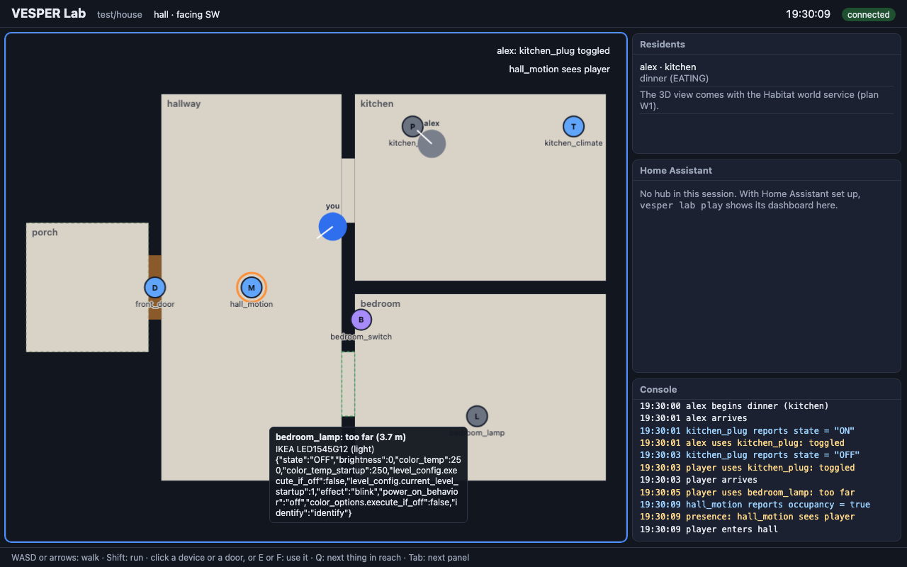

# VESPER Studio

**A smart-home simulation lab on a laptop: real market devices as virtual twins, living in homes from real 3D
scenes, with an unmodified Home Assistant as the hub.**

VESPER Studio maps 13,682 real products from the Zigbee2MQTT, Matter and Z-Wave catalogs to virtual devices, each
at the highest fidelity its public definition allows. It places them in a home: a small test house, or a real 3D
scene from the HSSD dataset. Scripted residents live their day there, and Home Assistant sees the devices exactly as
it would see real ones. You can walk the home yourself, as in a game, or let a day run in seconds. Every session is
recorded and replays exactly.

It is research software under active development. The research paper is *VESPER* (in preparation). A desktop app
for macOS and Windows is on the roadmap below. Today VESPER Studio runs from a terminal, with its page in your
browser.

## What you can do today

| | Command | Needs |
|---|---|---|
| Play a home in the browser, in 3D as in a game: walk, use devices, watch sensors and residents | `vesper lab play` | the catalog |
| Put a real Home Assistant in the loop, with its dashboard in the page | `vesper lab play --hub` | `vesper setup ha`, Mosquitto |
| Let the residents live a day in seconds, with the home's automations | `vesper lab day` | the catalog |
| Replay any session and check that it reproduces exactly | `vesper lab replay` | the catalog |
| Make a home from a real 3D scene (HSSD) | `vesper lab new --scene` | Habitat, HSSD |
| Find a product to place in a home | `vesper catalog search`, `vesper catalog show` | the catalog |
| Turn a persona schedule or an ARAS day into a resident's routine | `vesper lab routine` | — |
| Check the page automatically in a headless browser | `vesper lab look` | Chromium |
| Run the twins on MQTT, and validate them | `vesper twins run`, `vesper validate` | the catalog; some checks `vesper setup ha` |

## Requirements

- **macOS** (tested on Apple silicon) or **Linux**. On Windows, use WSL2 for now.
- **Python 3.11 or newer** and [uv](https://docs.astral.sh/uv/).
- **Node.js 20+ and npm**, to build the device catalog (the Zigbee definitions are JavaScript).
- Optional:
  - [Mosquitto](https://mosquitto.org/) and `vesper setup ha`, to put Home Assistant in the loop;
  - a Chromium-based browser, for `vesper lab look`;
  - Miniconda with habitat-sim 0.3.3 and the HSSD dataset, for homes from real 3D scenes (see below);
  - Habitat's humanoids, so the people in a home are Habitat's own avatars (see below).

## Install

    git clone https://github.com/huuhuannt1998/vesper_studio.git
    cd vesper_studio
    uv venv --python 3.12 .venv
    uv pip install --python .venv/bin/python -e ".[dev]"
    source .venv/bin/activate

Then build the device catalog once:

    vesper catalog sync        # downloads the pinned upstream sources (network, a few minutes)
    vesper catalog build       # builds the catalog offline (about a minute, 0.6 GB of memory)

Every command that runs twins refuses a catalog built by older catalog code, so rebuild after an update.

## Quickstart: play the example home

    vesper lab play examples/lab/test-house/home.yaml

Your browser opens on http://127.0.0.1:18080/ (add `--no-browser` to only print the address). The page shows the
test house in 3D: a hall, a kitchen, a bedroom and a porch, with six real Zigbee products. Alex, a resident, lives
there on a weekday routine. The test house has no 3D scene of its own, so it is drawn plainly from its map; a home
made from a real scene (below) is drawn from the scene itself.

| Control | What it does |
|---|---|
| **Click** the view | capture the mouse to look around (**Esc** lets it go) |
| **W A S D** or the arrow keys | walk where you look; hold two keys for a diagonal |
| **Shift** | run |
| **Click** or **F** | use what the crosshair is on: switch a plug, open a door, press a button |
| **E** | the same; with nothing under the crosshair, the thing in reach |
| **V** | first person or third person |
| **M** | the full map (a click on it uses a device or door too) |
| **Q** | select the next thing in reach |
| **Tab** | move to the next panel |

As in a game, the prompt under the crosshair says what a click will do ("Click: switch kitchen_plug on"), or why
it cannot ("too far (3.7 m)", "other side of the wall", "a sensor, not used by hand"). A browser without WebGL, or
the address with `?view=map`, plays on the map alone. The page also shows:
- in the header, the room you are in and the direction you face, and a compass at the top of the view;
- bottom right, the minimap;
- top right, the event feed: a sensor seeing someone, a door, a resident's action, an automation;
- the residents, and what each one is doing;
- the console, with every trace record in words.

Stop with Ctrl-C. The session's trace is in `examples/lab/test-house/traces/`.

## Home Assistant in the loop

    vesper setup ha                                        # Home Assistant Core in its own venv, once
    vesper lab play examples/lab/test-house/home.yaml --hub

VESPER starts its own Mosquitto (port 18830) and Home Assistant (port 18123). It puts the home's Zigbee devices on
the broker through a Zigbee2MQTT-compatible bridge and shows Home Assistant's dashboard in the page. It prints the
login and each device's Home Assistant entities.

The example home ships one automation: walking into the hall turns the bedroom lamp on. Edit automations in Home
Assistant's own editor. They are written back to the home's `automations.yaml` when play stops. VESPER never uses
the standard ports 1883 and 8123, so it does not disturb a Home Assistant you already run.

## A day in seconds, and exact replays

    vesper lab day examples/lab/test-house/home.yaml --hours 24
    vesper lab replay examples/lab/test-house/traces/<the printed trace>.jsonl

`lab day` runs the residents' routines on a logical clock. Without Home Assistant, VESPER's built-in engine runs the
home's `automations.yaml` itself: the same entities, the same triggers and the same commands. It names any
automation it cannot run. `lab replay` re-runs a trace and checks that every device report comes out the same.

## A home from a real 3D scene (HSSD)

Real homes come from [HSSD](https://huggingface.co/datasets/hssd/hssd-hab), a gated dataset (CC BY-NC 4.0). Accept
its license on Hugging Face, log in with `hf auth login`, and download it to `data/scene_datasets/hssd-hab`, or
point `VESPER_HSSD` at your copy. You can download it scene by scene: `vesper lab scenes` says which scenes are
complete, and names the files each one still needs.

VESPER reads the scenes with Habitat, which runs in its own environment:

    conda create -n vesper python=3.9 cmake=3.14.0
    conda install -n vesper habitat-sim=0.3.3 withbullet -c conda-forge -c aihabitat

VESPER looks for that environment's Python at `~/miniconda3/envs/vesper/bin/python`. Set `VESPER_HABITAT_PYTHON`
if yours is elsewhere. Then:

    vesper lab scenes                                          # the scenes here, and which are complete
    vesper lab new ~/vesper-homes/myhome --scene 102344022     # rooms, doorways, doors and the 3D scene, in ~10 s
    vesper catalog search ikea bulb                            # products to place (vesper catalog show <id>)
    vesper lab check ~/vesper-homes/myhome/home.yaml
    vesper lab play ~/vesper-homes/myhome/home.yaml

Keep homes made from HSSD outside this repository: their map files are derived from HSSD, which may not be
redistributed. A new home gets:
- the scene's rooms;
- its walkable floor, with the furniture in it;
- its doors, closed. HSSD's own metadata says which openings are doors and which are windows;
- its 3D scene (`render.json`): every mesh the scene draws, placed exactly where Habitat places it. The page draws
  the scene from HSSD's own files, so `vesper lab play` needs HSSD where the home was made, or `--hssd`.

For the people, download Habitat's humanoids, in the Habitat environment:

    python -m habitat_sim.utils.datasets_download --uids habitat_humanoids --data-path data/

`vesper lab play` then draws each person as the Habitat humanoid their avatar names (`female_0`, `male_1`, …),
walking with Habitat's own walk; it looks for them in `data/humanoids/humanoid_data`, or `VESPER_HUMANOIDS`, and
draws plain figures without them.

`lab new` names a door that opens onto no room of the map. In a scene with storeys, the home is the ground floor,
and `lab new` names the rooms it leaves out.

A home is a plain YAML file (`home.yaml`). It holds:
- the scene and its doors;
- the devices, and where each one is (a room, a wall, a table, a door);
- the player's avatar;
- the residents, with their routines and habits.

`vesper lab check` names every mistake and the nearest valid choice. The full format is in the design document
(`docs/superpowers/specs/2026-10-24-vesper-lab-design.md`).

## Residents and their routines

A resident lives a routine file: tasks with a time, a duration, a category and a room. Its profile holds its
habits:
- how often it forgets a light or the lock;
- when a room is too dark for it;
- its comfort band;
- its bedtime.

Residents walk the home and use the devices their activities need, opening doors on the way. They react to the
house: a dark room, a cold room, an alarm. Every action is recorded with who did it and why.

Routines can be made from earlier schedule data:

    vesper lab routine persona schedule.json --home ~/vesper-homes/myhome/home.yaml        # an LLM persona's day
    vesper lab routine aras DAY_1.txt --resident 1 --home ~/vesper-homes/myhome/home.yaml  # an ARAS day

## Checking the page automatically

    vesper lab look examples/lab/test-house/home.yaml --steps examples/lab/test-house/look-pubg.yaml

`lab look` drives the page in a headless browser, step by step (walk, press, click, aim, view, wait, expect). It
takes screenshots and writes a report. `look-3d.yaml` checks the 3D view: the crosshair, F, first person, the map.

## Development

    .venv/bin/python -m pytest          # about 820 tests, about a minute
    .venv/bin/ruff check vesper/lab vesper/catalog vesper/twins vesper/exposure vesper/validation vesper_world \
        tests/lab tests/catalog tests/twins tests/exposure tests/validation tests/world

Opt-in tests need real services:

| Variable | What it enables |
|---|---|
| `VESPER_HABITAT=1` | the world service in Habitat (scene 102344022 downloaded) |
| `VESPER_UI_BROWSER=1` | a real headless browser (the map and the 3D view) |
| `VESPER_STACK_TESTS=1` | a real Mosquitto |
| `VESPER_NETWORK_TESTS=1` | the upstream catalog sources |

Layout:

| Path | Contents |
|---|---|
| `vesper/catalog/` | the device catalog: sources, normalization, fidelity levels |
| `vesper/twins/` | the twins and their runtime (reporting rules, latency) |
| `vesper/exposure/` | the Zigbee2MQTT-compatible bridge and Home Assistant discovery |
| `vesper/validation/` | validation against Home Assistant |
| `vesper/lab/` | the Lab: homes, the map world, rules, residents, the automation engine, the play server and page (`ui/`), replay |
| `vesper_world/` | the world service, which runs in the Habitat environment (Python 3.9) |
| `vesper/agents/`, `automation/`, `core/`, `simulation/` | VESPER's first version, kept for its earlier experiments; the Lab does not use them |
| `examples/lab/test-house/` | the example home |
| `docs/superpowers/specs/` | the design documents |
| `docs/experiments/` | run books and results |

## Roadmap

- **Guided setup:** `vesper setup habitat`, scene downloads, and `vesper doctor`.
- **The security lab:** attacks and defenses, run against VESPER's own local services, with their alerts.
- **VESPER Studio for macOS and Windows:** one desktop app, with the setup built in.
- **The placement editor**, and Matter devices on the hub.

## License and data

The code is under the MIT license (see `LICENSE`).
- **Device catalog:** built on your machine from pinned upstream sources, under their own licenses:
  - Zigbee2MQTT's converters and Z-Wave JS's configuration (MIT);
  - connectedhomeip's Matter data model and Home Assistant's vocabulary (Apache 2.0);
  - the CSA's Distributed Compliance Ledger, whose terms are not yet verified, so its records are left out of a
    release build.

  `vesper catalog build --release` keeps only records whose sources allow redistribution.
- **3D data:** you download HSSD (CC BY-NC 4.0) and Habitat's humanoids yourself, under their own terms. Nothing
  derived from them is distributed.
